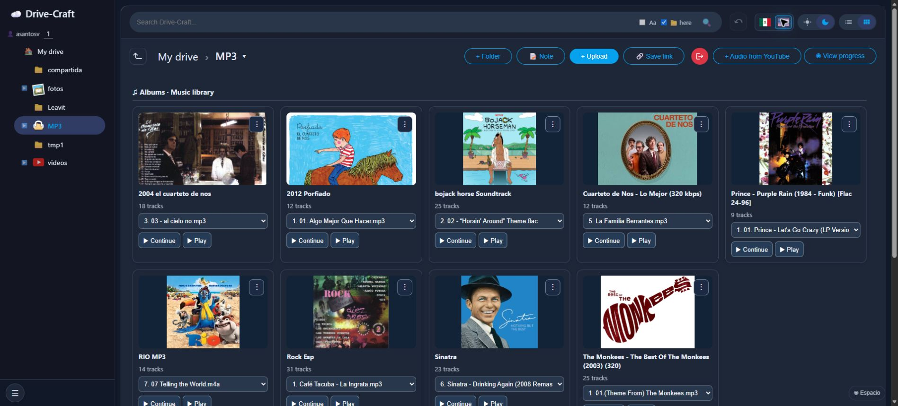
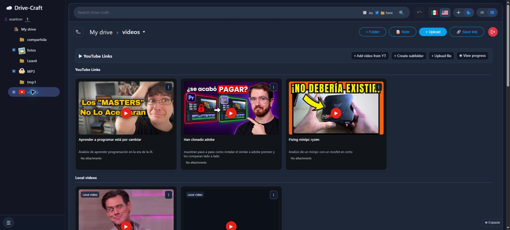

# Drivecraft

**Your files, notes and media collections, on your own server.**

[🇲🇽 Español](README.md) · 🇺🇸 **English**

Drivecraft is a personal file-management project that turns folders into photo albums, music libraries and video collections while retaining a familiar file-browser workflow. It started on Raspberry Pi; this deployment also offers a configurable x86_64 PC option.

> **Project status:** early development. The visual design and user experience are still immature and continue to evolve. The project's heart—its functional foundation for files, storage and media organization—is fairly solid in the author's everyday use. That is not a complete security audit or a production-stability guarantee. It is shared for testing, learning and improvement.

## A look at the application

Real screenshots from the author's installation. The displayed content demonstrates the interface and **is not included in the distribution**. Third-party names and artwork belong to their respective owners.

### Music library



### Links and local videos



## Features

- **File management:** folders, chunked uploads, search, favorites, version history and trash.
- **Fast Upload using Merkle trees:** recognizes existing copies to avoid repeated transfers; explained below.
- **Hardlink deduplication:** reuses stored content when the filesystem and permissions support it.
- **Media folders:** photo albums with thumbnails, music libraries, video collections, previews and playback-position tracking.
- **Notes:** plain text with optional word wrapping, and a Markdown editor with rich editing and editable Mermaid diagrams.
- **Sharing:** public links, upload-receiving links and per-user permissions.
- **Sessions:** inactivity-based expiration and management/revocation of open sessions.
- **External services:** import audio or video through a YouTube link or search, with background tasks and progress indicators. Availability depends on upstream changes.
- **Optional AI maintenance:** separate settings for reviewing external adapters. Disabled and without a token on a fresh installation.
- **Spanish/English interface**, persistent language selection and light/dark themes.
- **Standalone Docker deployment:** application, MariaDB and a background-job supervisor; administrator credentials are selected during installation.

## How Fast Upload works

The browser splits a file into chunks, calculates a **SHA-256** fingerprint for each chunk, and combines those fingerprints into a **Merkle tree**, producing a root fingerprint for the complete content. The server looks for a reusable copy using that fingerprint, the file size and additional checks.

When a valid match is found, Drivecraft can register the file using a **hardlink**, avoiding another full-content transfer and another physical copy. If no match exists or the fast path is unavailable, it falls back to normal chunked upload. Linear SHA-256 fingerprints remain supported for older files.

**Local fingerprinting still reads the file and uses CPU; the main benefit is avoiding repeated transfers of files already present.** This is not differential synchronization of changed blocks. Browser hashing may require a secure context: HTTPS or localhost.

## Try it locally

Requires Docker Engine with Compose v2 on Linux, or Docker Desktop using Linux containers on Windows/macOS.

```bash
git clone https://github.com/asantosv77/drivecraft.git
cd drivecraft/deploy
bash install.sh
```

On **Windows**, open `deploy/Instalar.cmd` after cloning or downloading and extracting the repository.

The wizard asks for architecture (**Raspberry Pi ARM64** or **x86_64 PC**), port, local/LAN access and administrator credentials. There is no universal password. Default URL: `http://localhost:8088/drive/`. The initial password must be changed at first login.

📖 **[Full installation and operations guide](deploy/README.en.md)** · **[Validation results and limitations](deploy/TESTS.en.md)**

### Storage

Physical space savings through hardlinks require a compatible Linux filesystem, such as **ext3/ext4, XFS or Btrfs**, within the same filesystem/volume. The deployment uses Docker named volumes and performs a real hardlink-support check. On Windows/macOS it uses Docker Desktop's Linux VM; do not assume the same guarantees with NTFS/exFAT/SMB shared folders.

### Scope of this initial distribution

- The clean deployment was tested on **x86_64**, including account creation, files, sharing links and persistence after restart.
- The **ARM64** option is prepared, but this new distribution has not yet received a complete native test on that architecture.
- Installs over local HTTP. Public Internet exposure requires your own HTTPS setup and a review of your environment's security settings.
- No accounts, passwords, stored files or configuration from the author's installation are included.
- Schema changes require reviewed migrations; back up data and configuration before updating.

## Contributing

Reproducible reports and focused improvements are welcome. Include architecture, Docker version, steps and expected behavior; remove passwords, tokens, private IP addresses and personal information from screenshots and logs. Code organization and visual polish are still evolving.

## Responsible use of content

Drivecraft **does not promote piracy**. Download and import features are intended for content you own, public-domain material or content you have permission to use. Respect copyright and the source service's terms. Technical availability does not grant permission to download or redistribute material.

The MIT license covers the project's original code; **it does not grant rights to third-party music, videos, images or other files**. Screenshots are illustrative; their media files are not included in the repository.

## Authorship and AI-assisted development

Created and maintained by **Armando Santos Villalobos**. Development uses AI tools, including **ChatGPT/Codex**, for implementation, debugging, review and documentation. Project decisions, integration and responsibility remain with the author.

## License

Original code is released under the [MIT license](LICENSE). Third-party dependencies and resources retain their own licenses and notices. Screenshots do not distribute the media files they display.
