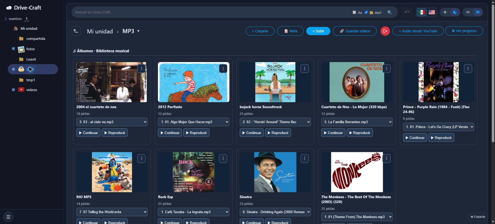
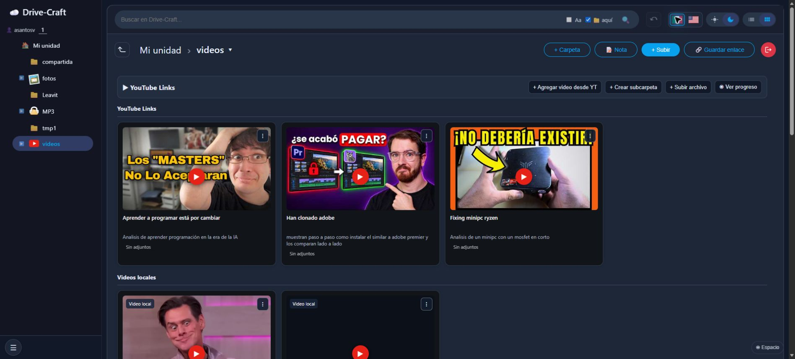

# Drivecraft

**Tu espacio de archivos, notas y colecciones multimedia, en tu propio servidor.**

🇲🇽 **Español** · [🇺🇸 English](README.en.md)

Drivecraft es un proyecto personal de gestión de archivos que convierte carpetas en álbumes de fotos, bibliotecas musicales y colecciones de video, sin perder la navegación de un explorador. Nació para Raspberry Pi y este despliegue también ofrece soporte configurable para PC x86_64.

> **Estado del proyecto:** desarrollo temprano. La presentación visual y la experiencia de uso todavía son inmaduras y siguen evolucionando. El alma del proyecto —su base funcional de archivos, almacenamiento y organización multimedia— es bastante sólida en el uso cotidiano del autor. Eso no equivale a una auditoría completa de seguridad ni a una garantía de estabilidad para producción; se comparte para probarlo, aprender y mejorarlo.

## Una mirada a la aplicación

Capturas reales de la instalación del autor. El contenido que aparece ilustra la interfaz y **no forma parte de la distribución**. Los nombres y portadas de terceros pertenecen a sus respectivos titulares.

### Biblioteca musical



### Enlaces y videos locales



## Características

- **Gestión de archivos:** carpetas, subidas por fragmentos, búsqueda, favoritos, historial de versiones y papelera.
- **Fast Upload con árboles de Merkle:** identifica copias existentes para evitar transferencias repetidas; explicación abajo.
- **Deduplicación mediante hardlinks:** reutiliza contenido almacenado cuando el sistema de archivos y los permisos lo permiten.
- **Carpetas multimedia:** álbumes fotográficos con miniaturas, bibliotecas musicales, colecciones de video, vistas previas y reproducción con progreso guardado.
- **Notas:** texto con ajuste de línea opcional y editor Markdown con modo enriquecido y diagramas Mermaid editables.
- **Compartición:** enlaces públicos, enlaces de recepción y permisos por usuario.
- **Sesiones:** caducidad por inactividad y consulta/revocación de sesiones abiertas.
- **Servicios externos:** importación de audio o video desde un enlace o búsqueda de YouTube, con tareas en segundo plano e indicadores de progreso. Su disponibilidad depende de cambios en el proveedor.
- **Mantenimiento opcional con IA:** configuración separada para revisar los adaptadores externos. Desactivado y sin token en una instalación nueva.
- **Interfaz español/inglés**, selector de idioma persistente y temas claro/oscuro.
- **Despliegue independiente con Docker:** aplicación, MariaDB y supervisor de trabajos; administrador definido durante la instalación.

## Cómo funciona Fast Upload

El navegador divide el archivo en fragmentos, calcula una huella **SHA-256** de cada uno y combina esas huellas en un **árbol de Merkle**, hasta obtener una huella raíz que representa el contenido completo. El servidor busca una copia reutilizable usando esa huella, el tamaño y verificaciones adicionales.

Si hay coincidencia válida, Drivecraft puede registrar el archivo usando un **enlace duro (hardlink)**, sin volver a enviar todo el contenido ni ocupar otra copia física. Si no hay coincidencia o la vía rápida no está disponible, continúa con la subida normal por fragmentos. También conserva compatibilidad con huellas SHA-256 lineales de archivos anteriores.

**El cálculo local sigue leyendo el archivo y consume CPU; la ganancia principal es evitar repetir la transferencia de archivos ya presentes.** No es sincronización diferencial de bloques modificados. Para calcular las huellas en el navegador puede requerirse un contexto seguro: HTTPS o localhost.

## Probarlo en tu equipo

Requiere Docker Engine + Compose v2 en Linux, o Docker Desktop con contenedores Linux en Windows/macOS.

```bash
git clone https://github.com/asantosv77/drivecraft.git
cd drivecraft/deploy
bash install.sh
```

En **Windows**, abre `deploy/Instalar.cmd` después de clonar o descargar y descomprimir el repositorio.

El asistente pregunta arquitectura (**Raspberry Pi ARM64** o **PC x86_64**), puerto, acceso local/red y credenciales del administrador. No hay contraseña universal. Por defecto: `http://localhost:8088/drive/`. En el primer acceso se exige cambiar la contraseña inicial.

📖 **[Guía completa de instalación y operación](deploy/README.md)** · **[Pruebas realizadas y límites](deploy/TESTS.md)**

### Almacenamiento

El ahorro físico por hardlinks requiere almacenamiento Linux compatible, como **ext3/ext4, XFS o Btrfs**, dentro del mismo sistema de archivos/volumen. El despliegue usa volúmenes nombrados de Docker y comprueba realmente que se puedan crear hardlinks. En Windows/macOS utiliza la máquina Linux de Docker Desktop; no presupongas las mismas garantías con carpetas compartidas NTFS/exFAT/SMB.

### Alcance de esta primera distribución

- Se probó el despliegue limpio en **x86_64**, incluyendo creación de cuenta, archivos, enlaces y persistencia tras reinicio.
- La opción **ARM64** está preparada, pero esta distribución nueva aún no tiene una prueba nativa completa en esa arquitectura.
- Instala por HTTP local. Si la expones a Internet, debes configurar HTTPS y revisar la configuración de seguridad de tu entorno.
- No se incluyen usuarios, contraseñas, archivos ni configuración de la instalación del autor.
- Los cambios de esquema requieren migraciones revisadas; respalda datos y configuración antes de actualizar.

## Contribuir

Se agradecen reportes reproducibles y mejoras pequeñas. Indica arquitectura, versión de Docker, pasos y resultado esperado; elimina contraseñas, tokens, IP privadas y datos personales de capturas y logs. La organización del código y el acabado visual siguen en evolución.

## Uso responsable del contenido

Drivecraft **no fomenta la piratería**. Las funciones de descarga e importación están destinadas a contenido propio, de dominio público o para el que tengas permiso. Úsalas respetando los derechos de autor y las condiciones del servicio de origen. La disponibilidad técnica de una descarga no equivale a autorización para obtenerla o redistribuirla.

La licencia MIT cubre el código propio del proyecto; **no concede derechos sobre música, videos, imágenes ni otros archivos de terceros**. Las capturas son ilustrativas y sus medios no se incluyen en el repositorio.

## Autoría y desarrollo asistido

Creado y mantenido por **Armando Santos Villalobos**. El proyecto se desarrolla con apoyo de herramientas de IA, incluido **ChatGPT/Codex**, en implementación, depuración, revisión y documentación. Las decisiones, integración y responsabilidad del proyecto permanecen en su autor.

## Licencia

Código propio bajo [licencia MIT](LICENSE). Las dependencias y recursos de terceros conservan sus licencias y avisos. Las capturas no distribuyen los archivos multimedia que muestran.
